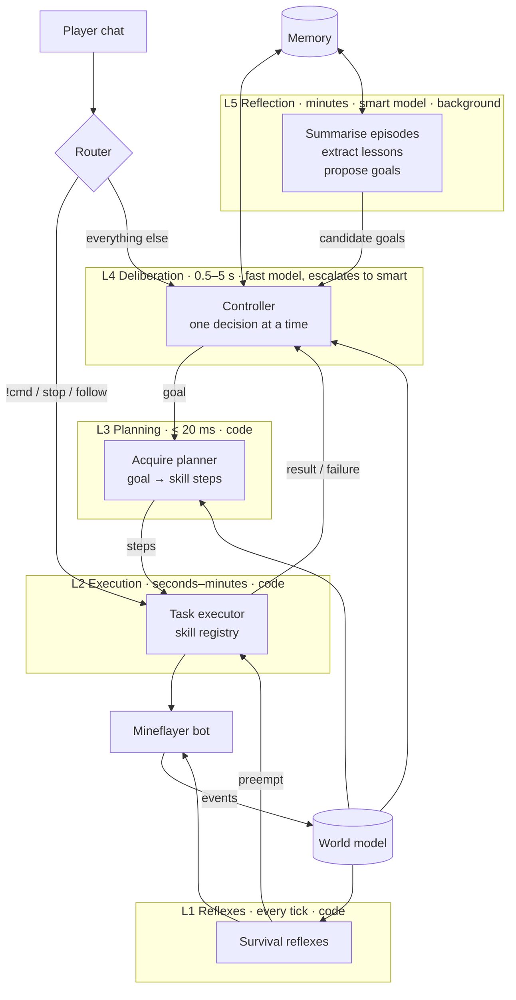

# OpenNova Agent — Architecture

Status: Phases 0–5 are implemented in a first version (see §20 for exactly
what exists and where it differs from this design). It has unit and
integration tests on a stub bot but has **not yet been run in a real
Minecraft world**.
Scope: turn OpenNova from a `!command` bot into an autonomous companion that
understands plain-language orders, plans the steps, acts, recovers from
failure, and finds useful work on its own.

---

## 1. Goals and how we measure them

"Best player" is not a design target until it is a number. These are the
numbers the project is judged on. Every phase in §14 must move at least one.

| Metric | Target | Why it matters |
|---|---|---|
| Order success rate (benchmark set of 50 orders) | ≥ 90 % | Smart |
| Fresh spawn → iron pickaxe, no human help | ≤ 10 min | Smart + fast |
| Fresh spawn → diamond pickaxe | ≤ 45 min | Long-horizon planning |
| Deaths per hour of autonomous play | ≤ 0.2 | Survival reflexes |
| `stop` order → body idle | ≤ 250 ms | Control, safety |
| Order → first visible action (simple order) | ≤ 300 ms | Feels responsive |
| Order → first visible action (needs LLM) | ≤ 2 s | Feels responsive |
| LLM calls per completed task (median) | ≤ 3 | Cost, speed |
| Tokens per completed task (median) | ≤ 6 k | Cost |
| Works on a local 8B–32B model for direct orders | yes | No mandatory API bill |

Non-goals for v1: multi-agent societies, competitive PvP against humans,
vision from pixels, redstone engineering, speedrun-grade movement tech.

---

## 2. The core idea: think rarely, act in code

The single most important decision in this design:

> **The LLM chooses *what* to achieve. Code works out *how* and does it.**

A model call takes 0.5–5 s and can be wrong. A function call takes
microseconds and is exact. So everything that *can* be exact is code:

- Recipe trees, tool tiers, smelting, drops → deterministic planner (§7).
- Eating, fleeing, fighting back, not walking into lava → reflexes (§6).
- Walking, digging, placing, container handling → skills (§5).

The model is left with the things only a model can do: understand language,
choose between goals, and decide what to try when the plan breaks.

This is what makes the agent fast, cheap, and able to run on a small model.
It is also what separates it from a pure ReAct bot that asks the model for
every single step.

---

## 3. Layers

Five layers, each slower and smarter than the one below. A higher layer never
does a lower layer's job.



| Layer | Runs | Latency budget | Uses LLM |
|---|---|---|---|
| L1 Reflexes | every physics tick (50 ms) | < 5 ms per tick | never |
| L2 Execution | while a task is active | n/a | never |
| L3 Planning | on each new goal and each re-plan | < 20 ms | never |
| L4 Deliberation | on order, on failure, on idle | p50 < 1.5 s | fast model |
| L5 Reflection | idle time, every N minutes | none (background) | smart model |

### One controller, one decision

Borrowed from Altera's PIANO design: many modules run at once, but exactly
one — the Controller — makes decisions, and both the chat reply and the
action come out of the *same* decision. This prevents the classic failure
where the bot says "on my way" while doing something else.

---

## 4. The body is a single resource

Today two commands can run at once and fight over the pathfinder
(`src/bot.js:193` does not await). The agent fixes this with one rule:

> **Exactly one task owns the body at any time.**

### Task executor

- One active task, one priority queue of pending tasks.
- Every skill receives an `AbortSignal`. Cancelling is the only way to stop
  a skill, and every skill must honour it within one tick.
- Priorities, highest first:

| Priority | Source | Example |
|---|---|---|
| 100 | Reflex | flee, eat, surface for air |
| 80 | Kill switch | `stop` |
| 60 | Owner order | "bring me 10 oak logs" |
| 40 | Trusted-player order | same, from a friend |
| 20 | Maintenance | deposit full inventory, repair tools |
| 10 | Self-chosen goal | upgrade to iron armour |

- A higher-priority task **preempts**: the running skill is aborted, the
  interrupted goal goes back on the queue.
- **Resume is free.** Goals are declarative ("have 3 iron_ingot"), not
  scripts. On resume the planner simply re-plans from the current inventory
  and world, so partial progress is kept automatically and there is no saved
  program counter to corrupt.

---

## 5. Skills

### Contract

Every skill is one module with this shape:

```js
module.exports = {
  name: 'mine_block',
  description: 'Mine N blocks of a type and collect the drops.',
  params: { /* JSON Schema */ },
  timeoutMs: 120_000,
  danger: 'none',            // none | world_edit | destructive | hostile
  async run(ctx, args, signal) {
    // ...
    return ok({ mined: 3 });
    // or
    return fail('NO_BLOCK_IN_RANGE', 'no iron_ore within 64 blocks', { searched: 64 });
  }
};
```

Rules:

1. **Never call `bot.chat`.** Skills return data; the caller decides what to
   say. (Today the chest logic in `src/commands/inventory.js` breaks this.)
2. **Always return a result object** `{ ok, code, message, data }`. Never a
   bare boolean, never throw for an expected failure.
3. **Failure codes are a fixed enum** — `MISSING_ITEM`, `NO_BLOCK_IN_RANGE`,
   `NO_PATH`, `NEED_TOOL_TIER`, `INVENTORY_FULL`, `TIMEOUT`, `ABORTED`,
   `UNSAFE`, `NOT_FOUND`, `BLOCKED`. The planner and the model branch on the
   code; the message is for humans and logs.
4. **Honour `signal`** and the declared timeout.
5. **Idempotent where possible**: asking for 3 logs when 3 are already held
   returns `ok` immediately.

### One registry, three consumers

The registry is the single source of truth. From it we generate:

- the LLM tool definitions (name, description, JSON Schema),
- the `!commands` (thin adapters: parse args → run skill → chat the result),
- the planner's action set.

Adding a skill is adding one file. Nothing else needs editing.

### Skill inventory

| Group | Skills | Status |
|---|---|---|
| Move | `goto`, `goto_player`, `follow`, `goto_waypoint`, `explore` | `explore` new |
| Gather | `mine_block`, `chop_tree`, `collect_drops`, `strip_mine`, `harvest_crop`, `kill_for_loot` | last two new |
| Make | `craft`, `smelt`, `place_block`, `build_shelter` | last two new |
| Store | `deposit`, `withdraw`, `scan_chest`, `give_to_player`, `equip`, `drop` | move out of commands; `give_to_player` new |
| Survive | `eat`, `sleep`, `flee`, `defend`, `guard_player`, `light_area` | refactor |
| Farm | `till_and_plant`, `breed` | new |
| Meta | `obtain` (§7), `remember`, `recall`, `say`, `wait` | new |

`obtain(item, count)` is the skill the model will call most. It is not one
action — it invokes the planner.

---

## 6. Reflexes (L1)

A small rule engine evaluated every tick against the world model. No LLM, no
async waits in the decision. Each reflex is `{ when, priority, action }`.

| Reflex | Trigger | Action |
|---|---|---|
| Kill switch | owner says `stop` / `!stop` | abort everything, clear queue |
| Air | oxygen ≤ 6 | swim up, abort current task |
| Fire / lava | on fire or lava adjacent | move off, seek water |
| Fall guard | next step drops > 3 blocks | refuse the step |
| Flee | health ≤ flee threshold and hostile near | flee, then eat |
| Fight back | hit by mob, health OK | equip best weapon, attack |
| Creeper | creeper within 4 blocks, fuse lit | sprint away 8 blocks |
| Eat | food ≤ 14 and not in combat | eat best food |
| Night | dusk, no shelter, mode ≠ `obey` | queue `sleep` or `build_shelter` |
| Inventory full | ≤ 2 free slots | queue `deposit` (maintenance) |
| Tool break | held tool durability < 5 % | swap, queue replacement |

Reflexes preempt through the task executor like anything else, so the
interrupted goal resumes automatically afterwards.

The existing `setInterval` defend loop in `src/skills/combat.js` and the
auto-eat plugin are replaced by this engine so there is one place that
decides, not three.

---

## 7. The acquire planner (L3)

The biggest single win in the design. Given `have(item, n)`, it returns an
ordered list of skill calls. It is a pure function of
(goal, inventory, world model, memory), so it is unit-testable without a
server.

### How it resolves an item

Backward chaining. For each needed item, try sources cheapest first:

1. **Inventory** — already held.
2. **Known chests** — memory says a chest holds it → `withdraw`.
3. **Craft** — recipe from `minecraft-data` → recurse on ingredients;
   insert `place crafting_table` if the recipe needs one.
4. **Smelt** — furnace table → recurse on input + fuel + furnace.
5. **Mine** — block that drops it → check required tool tier → recurse on
   the tool → `mine_block`.
6. **Hunt** — mob that drops it → `kill_for_loot`.
7. **Harvest / farm** — crops, saplings.
8. **Unknown** — return `fail('NOT_FOUND')` with what *was* resolved, so the
   model can ask the player or go exploring.

Each source has a cost estimate (seconds). The planner picks the cheapest
complete tree, memoises sub-results, and merges duplicate needs (two recipes
both needing sticks produce one stick step with the summed count).

Example — `have(iron_pickaxe, 1)` from an empty inventory resolves to:

```
chop_tree(4) → craft(planks) → craft(crafting_table) → craft(stick)
→ craft(wooden_pickaxe) → mine_block(stone,11) → craft(stone_pickaxe)
→ craft(furnace) → mine_block(iron_ore,3) → mine_block(coal_ore,1)
→ smelt(raw_iron,3) → craft(iron_pickaxe)
```

Twelve steps, zero model calls.

### Data sources

- Recipes, block drops, harvest tools, mob loot: `minecraft-data`
  (already a dependency).
- Smelting recipes and fuel values: a small hand-kept JSON table in
  `src/agent/planner/data/`, because `minecraft-data` coverage of furnace
  recipes must be verified in Phase 0 before relying on it.
- Where things are: spatial memory (§9).

### Re-planning

When a step fails the executor re-plans once from current state. Only if the
*same step fails twice with the same code* does control go up to the model,
with the failure code and the remaining plan. This keeps the model out of
ordinary hiccups (a mob wandered into the path, a block was already gone).

---

## 8. Deliberation (L4)

### Router — skip the model when you can

Every chat line goes through a router first:

| Input | Route | Cost |
|---|---|---|
| `!command …` | command adapter → skill | 0 LLM calls |
| `stop`, `come`, `follow me`, `stay` (fixed phrase table, several languages) | skill directly | 0 LLM calls |
| Addressed to the bot, anything else | Controller | 1+ LLM calls |
| Not addressed to the bot | recorded in memory only | 0 LLM calls |

"Addressed" means: a whisper, the bot's name is mentioned, or it is a reply
within 30 s of the bot speaking to that player.

### Controller loop

Plan-then-execute, **not** step-by-step ReAct.

```
1. Build context  (system prompt + tools + world snapshot + memories + order)
2. Model returns ONE of:
     - act(goal or ≤ 5 tool calls) + optional say(text)
     - ask(question)            when the order is ambiguous
     - escalate(reason)         fast model asking for the smart model
3. say() is sent to chat immediately; the goal goes to the planner/executor
4. Executor runs to completion with no further model calls
5. On success  → short confirmation from a template, no model call
   On failure  → back to step 1 with the failure result appended
6. Hard limit: 6 deliberation rounds per order, then report honestly
```

Step 5 matters for speed: "Done — 10 oak logs are in your chest" is a
template filled from the result data, not a generation.

### Two model roles

| Role | Job | Example choices |
|---|---|---|
| `fast` | parse orders, pick goals, routine recovery, chat | local Qwen-class 8B–32B via Ollama, or `claude-haiku-5-5` |
| `smart` | vague goals, repeated failure, reflection, goal generation | `claude-sonnet-5-5` / `claude-opus-5-5`, or a larger local model |

Escalation from `fast` to `smart` happens when any of these is true:

- the fast model returns `escalate`,
- two deliberation rounds on the same order have failed,
- loop detection fires (same tool + same args chosen twice in a row),
- the fast model's output fails schema validation twice.

If no `smart` model is configured, escalation degrades to "tell the player
what is blocking and ask".

### Provider layer

One `LLMClient` interface: `complete({ role, system, messages, tools }) →
{ text, toolCalls, usage }`. Two adapters:

- **OpenAI-compatible** — covers Ollama, vLLM, LM Studio, and most hosted
  APIs.
- **Anthropic** — native tool use and prompt caching.

The model is a line in config. Nothing above this layer knows the provider.

### Prompt layout (built for caching)

Order is fixed, most stable first, so the provider's prompt cache (or a
local model's KV cache) reuses the prefix on every call:

1. System prompt — identity, rules, output contract. *Static.*
2. Tool definitions — from the skill registry. *Static per build.*
3. Long-term facts — home, owner preferences, standing orders. *Changes rarely.*
4. Retrieved memories — top-k for this order. *Per call.*
5. World snapshot — compact, see §9. *Per call.*
6. Recent turns — last few orders and results. *Per call.*

Target total: under 3 k tokens for a typical call.

### Guarding against bad output

- Tool arguments are validated against the JSON Schema before anything runs.
  Invalid → one automatic retry with the validation error, then escalate.
- Item and block names are fuzzy-matched to real registry names
  (`oak log` → `oak_log`); unknown names are rejected with the three
  closest matches, so the model can correct itself.
- Counts and radii are clamped to sane maxima.

---

## 9. World model and perception

### Event-driven, not polled

A `WorldModel` object subscribes to Mineflayer events (`health`, `move`,
`entitySpawn`, `entityGone`, `blockUpdate`, `playerCollect`, `time`, …) and
keeps a current, cheap-to-read picture. Reflexes and the planner read it
synchronously; nobody calls `bot.findBlocks` in a hot path.

Block scans are the expensive operation, so they are budgeted:

- Scans run on a timer in the background (not on demand), time-sliced to
  ≤ 4 ms per tick.
- Results land in a chunk-indexed resource index: "iron_ore seen at …".
- The index is invalidated by `blockUpdate` and chunk unload.

### Snapshot for the model

A renderer turns the world model into a compact, stable text block:

```
self: hp 18/20 food 15/20 pos (104,64,-33) overworld plains day(6400) clear
held: stone_pickaxe(81%)  armour: none
inv(21/36): oak_log 12, cobblestone 64, raw_iron 3, coal 5, bread 4, …
near: Aryan 6m N · cow×3 12m E · crafting_table 3m · furnace 4m
resources seen: iron_ore 14m (3) · coal_ore 9m (6) · oak_log 22m (many)
threats: none
task: idle
```

Rules: fixed field order, counts not coordinates unless useful, nearest-first,
hard cap of 600 tokens, inventory truncated by relevance to the current
order.

No pixels in v1. An optional later module can render a frame for a
vision-capable model to check builds.

---

## 10. Memory

### Stores

| Store | Holds | Used by |
|---|---|---|
| Working | current order, active plan, last ~10 events | every model call |
| Spatial | waypoints, home, chests + contents, resource sightings, structures | planner, snapshot |
| Episodic | timestamped log of what happened: orders, outcomes, deaths, discoveries | retrieval |
| Lessons | "X failed because Y; do Z" rules extracted by reflection | retrieval |
| Social | per player: trust level, preferences, standing orders, last seen | prompt facts |
| Macros | named, saved plans ("restock food") | Controller tool |

### Storage decision: SQLite

`better-sqlite3`, one file at `data/nova.db`.

- Fast synchronous reads, which reflexes and the planner need.
- Full-text search (FTS5) for episodic and lesson retrieval — good enough
  recall without an embedding model or a vector database, and it works
  offline.
- The existing `data/*.json` files are imported once on first start and then
  left untouched as a backup.

Embeddings are deliberately deferred. Retrieval is keyword + recency +
importance score. If the benchmark shows retrieval is the weak point, an
embedding column can be added without changing callers.

### Retrieval

For each model call: top 5 by `relevance(FTS) × recency decay × importance`,
plus every lesson whose trigger matches the current goal's item or skill.
Lessons are capped and deduplicated so the store cannot grow into noise.

### Reflection (L5)

Runs in the background when idle, on the `smart` model:

1. Summarise the last N episodes into a few sentences; drop the raw rows
   older than a retention window.
2. For each failure that needed model intervention, write one lesson.
3. Update social facts ("Aryan prefers spruce for building").
4. Propose candidate goals for the autonomy system.

---

## 11. Autonomy

### Modes

| Mode | Behaviour |
|---|---|
| `obey` | Acts only on orders. Reflexes still protect the bot. |
| `assist` (default) | Orders, plus maintenance: restock food, deposit, repair, light the base, sleep. |
| `auto` | All of the above, plus self-chosen goals when idle. |

Set by the owner in chat or config. An order always outranks a self-chosen
goal and preempts it.

### Choosing a goal without burning tokens

Goal generation is mostly code. A scoring function ranks candidates from
three sources:

1. **Needs** — computed from state: low food stock, no bed, no shelter,
   tools near breaking, inventory full.
2. **Progression** — a data file describing the tech tree as milestones
   (wood → stone → iron → shield + armour → diamond → enchanting → nether →
   …). The next unmet milestone is always a candidate. Each milestone is
   just a list of `have(item, n)` goals, so the planner already knows how to
   reach it.
3. **Standing orders and reflection proposals** — "keep the furnace chest
   stocked with coal".

The top candidate above a threshold runs directly. The model is consulted
only to break ties or when nothing scores well — roughly one call per goal,
not per step.

### Stuck detection

A watchdog tracks position, inventory and task progress. No change for 60 s
during an active task → abort and re-plan. Three aborts on one goal → shelve
it with a cool-down and write an episode, so the bot never grinds on the
same wall forever.

---

## 12. Safety and permissions

An agent that takes natural-language orders from chat is a prompt-injection
target. This is designed in, not bolted on.

### Trust levels

| Level | Who | May |
|---|---|---|
| `owner` | `settings.owner` (finally enforced) | everything, change mode and trust |
| `trusted` | named by the owner | harmless orders: fetch, follow, craft |
| `stranger` | everyone else | be replied to; cannot command |

### Rules

- **Chat from non-owners is data, not instructions.** It is passed to the
  model inside a marked block and the system prompt says so. Skill calls
  are additionally checked against the *speaker's* trust level in code, so
  a persuaded model still cannot act for a stranger.
- **Danger classes are enforced in code.** Each skill declares `danger`.
  `destructive` (drop everything, break chests) and `hostile` (attack a
  player) need an explicit owner order in the current turn — a self-chosen
  goal can never trigger them.
- **Protected regions.** Home and any owner-marked area: the bot will not
  break or place blocks there unless the order names the region.
  Pathfinder digging is disabled inside them.
- **No server commands.** Outgoing chat is sanitised: a message may not
  begin with `/` unless it is on a small allowlist (e.g. `/msg`).
- **No model-written code is ever executed.** Voyager-style skill synthesis
  is rejected for v1. New behaviour is learned as *macros* — stored
  sequences of validated skill calls — which are data and go through the
  same permission checks.
- **Budgets.** Per-hour caps on model calls and tokens. When hit, the bot
  drops to `obey` mode and says so.

---

## 13. Speed and cost: the decision list

Collected in one place because "faster and optimised" was an explicit ask.

| # | Decision | Effect |
|---|---|---|
| 1 | Plan in code, not in the model (§7) | Most tasks need 1 model call instead of 10–30 |
| 2 | Plan-then-execute, not per-step ReAct (§8) | No model latency between actions |
| 3 | Router and phrase table before the model (§8) | Common orders start in < 300 ms |
| 4 | Templated success replies | Removes a model call per task |
| 5 | Two model tiers with escalation | Cheap by default, smart when needed |
| 6 | Cache-ordered prompt, static prefix | Lower latency and cost on every call |
| 7 | Snapshot capped at 600 tokens | Small prompts, fast local inference |
| 8 | Event-driven world model, background time-sliced scans | No tick stalls |
| 9 | Synchronous SQLite, FTS instead of embeddings | Sub-millisecond memory reads, no extra model |
| 10 | Speak the acknowledgement before acting | Perceived latency near zero |
| 11 | Reflexes in the tick loop, never waiting on a model | Survives things a 2 s think cannot |
| 12 | Long trips split into ≤ 64-block legs | Avoids pathfinder timeouts beyond loaded chunks |
| 13 | Pathfinder tuned: think timeout, dig cost by tool, no digging in protected regions | Fewer stalls, less griefing |
| 14 | Dependencies pinned to exact versions | No behaviour change on `npm install` |
| 15 | One body owner, abortable skills | No wasted or conflicting actions |

---

## 14. Code layout

Existing files move; nothing is thrown away.

```
src/
  index.js                    entry (unchanged role)
  bot.js                      connect, plugins, wire the modules
  core/
    result.js                 ok() / fail() / error codes
    task-executor.js          queue, priorities, preemption, AbortSignal
    world-model.js            event-driven state
    resource-index.js         background block scans, chunk index
    permissions.js            trust levels, danger classes, regions
    watchdog.js               stuck detection
  skills/
    registry.js               loads skills, emits tools + commands
    move/ gather/ make/ store/ survive/ farm/ meta/
  reflexes/
    engine.js                 per-tick rule evaluation
    rules/                    one file per reflex
  planner/
    acquire.js                backward-chaining item resolver
    sources/                  inventory, chest, craft, smelt, mine, hunt, harvest
    cost.js
    data/                     smelting.json, fuel.json, progression.json
  agent/
    router.js                 !cmd / phrase table / addressed-to-me
    controller.js             deliberation loop, escalation
    prompt.js                 cache-ordered prompt builder
    snapshot.js               world model → text
    goals.js                  autonomy: needs, progression, scoring
    reflection.js             background summarise / lessons
  llm/
    client.js                 interface + role selection + budgets
    openai-compatible.js
    anthropic.js
  memory/
    db.js                     SQLite schema, migrations, JSON import
    spatial.js episodic.js lessons.js social.js macros.js
    retrieve.js
  commands/
    adapter.js                generates !commands from the registry
  trace/
    tracer.js                 JSONL decision trace
test/
  planner/                    pure unit tests, no server
  skills/                     contract tests with a mocked bot
  bench/                      benchmark orders + runner
docs/
  ARCHITECTURE.md
```

Language stays plain JavaScript (CommonJS) to match the repo, with JSDoc
types and `ajv` for schema validation. Node ≥ 22.

---

## 15. Observability and testing

### Decision trace

Every deliberation writes one JSONL record: order, snapshot, retrieved
memories, prompt token count, model, latency, raw response, validated tool
calls, plan, each step's result and duration. This is the only way to debug
"why did it do that", and it is the input to the benchmark report.

### Test levels

| Level | What | Needs a server |
|---|---|---|
| Unit | planner trees, cost, router, snapshot, permission checks | no |
| Contract | every skill returns a valid result and honours abort (mocked bot) | no |
| Replay | recorded traces re-run against a new prompt or model, tool calls compared | no |
| Benchmark | 50 scripted orders + the spawn-to-iron and spawn-to-diamond runs on a fixed seed | yes |

The benchmark is run for every model considered, which turns "do I need a
bigger model?" into a table instead of a guess.

---

## 16. Roadmap

Each phase is usable on its own and ends with a measurable exit test.

| Phase | Work | Exit test |
|---|---|---|
| **0 Foundations** | Upgrade and pin dependency versions; verify 26.1 (§18); result type; skill contract; registry; task executor with abort; enforce `owner`; move chest logic into skills; `!commands` generated from registry | All existing commands work through the registry; `stop` halts within 250 ms; two overlapping commands no longer conflict |
| **1 Planner** | World model; acquire planner with all sources; smelting/fuel tables; `obtain` skill | `!obtain iron_pickaxe` succeeds from an empty inventory with zero model calls |
| **2 Brain** | LLM client + both adapters; router; snapshot; controller loop; validation and fuzzy names; trace | ≥ 80 % on the 50-order benchmark with the fast model |
| **3 Survival** | Reflex engine and all rules; watchdog; remove old interval loops | ≤ 0.2 deaths/hour over a 3-hour night-inclusive run |
| **4 Memory** | SQLite, JSON import, episodic + lessons + social, retrieval, reflection | Repeating a previously failed order succeeds without escalation |
| **5 Autonomy** | Modes, needs, progression file, goal scoring, macros | Spawn → iron pickaxe ≤ 10 min and → diamond pickaxe ≤ 45 min unattended |
| **6 Breadth** | Building, farming, exploring, trading; optional vision check | ≥ 90 % on the benchmark including build and farm orders |

Phases 0 and 1 use no model at all. That is deliberate: the bot becomes
substantially more capable before any API key or GPU is involved, and the
model in Phase 2 starts on top of a body that already works.

---

## 17. Decisions summary

| Area | Decision | Rejected alternative |
|---|---|---|
| Who plans | Code plans item acquisition; model picks goals | Model plans every step |
| Control loop | Plan-then-execute, re-plan on failure | Per-step ReAct |
| Concurrency | One body owner, priority preemption | Free-running concurrent commands |
| Resume | Declarative goals, re-plan from state | Saved script position |
| Models | Two roles, fast default, escalate to smart | One large model for everything |
| Provider | Neutral interface, OpenAI-compatible + Anthropic adapters | Hard-wired to one vendor |
| Learning | Macros and lessons as data | Model-written code (Voyager-style) |
| Memory store | SQLite + FTS5 | JSON files; vector database |
| Perception | Text snapshot from event-driven model | Screenshots / vision |
| Reflexes | Tick-loop rule engine, no LLM | Asking the model in emergencies |
| Autonomy | Scored needs + progression data, model breaks ties | Model invents every goal |
| Safety | Trust and danger classes enforced in code | Relying on the system prompt |
| Language | JavaScript + JSDoc + JSON Schema | TypeScript migration first |
| Commands | Kept, generated from the skill registry | Removed in favour of chat only |

## 18. Minecraft version compatibility

Checked on 2026-11-17 against the npm registry.

| Item | Version |
|---|---|
| Latest Minecraft Java release | 26.3 |
| Newest version Mineflayer 4.39.0 lists as tested | 26.1 |
| Newest Java version in `minecraft-data` 3.119.0 | 26.1 |
| Mineflayer in this repo's lockfile | 4.33.0 |
| Node required by Mineflayer 4.39.0 | ≥ 22 |

Decisions:

- **Target 26.1**, the newest version the libraries support. Fall back to
  1.21.11 if Phase 0 testing shows a plugin misbehaving on 26.1.
- **Upgrade Mineflayer to 4.39.0** and pin it exactly. Raise the README's
  Node requirement from 18 to 22.
- **Only Mineflayer touches the game protocol.** The planner reads recipes
  and drops from `minecraft-data` for whatever version the bot connects
  with, and nothing in `agent/`, `planner/` or `memory/` hard-codes a
  version. Moving to a newer Minecraft is a dependency bump plus a
  benchmark run.
- **Plugin risk.** `mineflayer-pathfinder` (last release 2023),
  `mineflayer-pvp` (2022) and `mineflayer-tool` (2022) are no longer
  updated. They sit on top of Mineflayer's API, not the protocol, so they
  usually keep working, but each is wrapped by one skill module so it can
  be replaced without touching the rest. The reflex engine already
  replaces most of what `pvp` and `auto-eat` do.

## 19. Open questions

These need a running server or a product choice and are not settled here:

1. Whether `minecraft-data` exposes enough smelting and loot data for the
   target version, or the hand-kept tables must be larger.
2. Which specific local model is the default — decided by the Phase 2
   benchmark, not in advance.
3. Whether the bot should speak in the player's language automatically.

## 20. Implementation status

What exists in the code today, against the design above.

| Area | Built | Differs from the design / not built |
|---|---|---|
| Result type, error codes | `src/core/result.js` | — |
| Task executor | `src/core/task-executor.js`: priorities, preemption, resume, abort, timeouts, background tasks | — |
| Permissions | `src/core/permissions.js`: owner / trusted / stranger, danger classes, protected home, chat sanitising | With no owner configured, the first player to speak becomes owner (and is saved) |
| Skills | 33 skills in `src/skills/defs/`, one registry | No building, farming, trading or shelter skills yet |
| Planner | `src/planner/acquire.js`: chest, craft, smelt, mine, hunt; cost ranking; reservations; hoisted gathering | Crop farming is not a source: bread needs wheat already growing nearby |
| World model | `src/core/world-model.js` | Scans run on demand with a 4 s cache, not as a background time-sliced index |
| Reflexes | `src/reflexes/engine.js`: air, creeper, flee, fight back, eat | Runs every 250 ms, not every tick. No fall guard, lava escape, night shelter or tool-break rule |
| LLM layer | `src/llm/`: Anthropic (official SDK), Gemini, and one OpenAI-compatible adapter for OpenAI, OpenRouter, Groq, DeepSeek, Mistral, xAI, Together, Ollama, LM Studio and custom endpoints | — |
| Controller | `src/agent/controller.js`: plan-then-execute, escalation, loop detection, templated confirmations | — |
| Router | `src/agent/router.js`: phrase table in English plus a few Hindi, Spanish and French phrases | — |
| Memory | `src/memory/store.js`: episodes, lessons, facts in SQLite with FTS5 | Uses Node's built-in `node:sqlite` instead of `better-sqlite3` (no native build). Home, waypoints and chests stay in the existing JSON files so legacy commands share them |
| Lessons | Stored by the controller when a failed attempt is followed by a working one | The background reflection pass (L5) is not built |
| Autonomy | `src/agent/goals.js`: three modes, needs (sleep, storage, food), progression file | Fully deterministic; the model is not consulted to break ties. Macros are not built |
| Trace | `src/trace/tracer.js`: one JSON line per order in `logs/` | Replay tool and benchmark runner are not built |
| Commands | New `!ask !obtain !plan !do !skills !mode !trust !untrust !agent` | The 70+ existing commands are kept as they were rather than regenerated from the registry. They now require owner or trusted status, and an action command cancels whatever the agent was doing |
| Stuck detection | Travel stall detection and per-skill timeouts | No separate watchdog |

Bugs fixed in existing code along the way:

- `src/skills/survival.js` called `bot.autoEat.enable()`, which does not
  exist in the pinned `mineflayer-auto-eat` 5.0.3 and would throw on spawn.
- The old crafting path passes the wanted *item* count to `bot.craft`,
  which expects the number of *recipe runs* (so 4 planks asked for 4 runs).
  The new `craft` skill converts correctly; the legacy `!craft` command is
  unchanged.

Known and not fixed: the existing commands `finditem` and `find` both
declare the alias `locate`.
